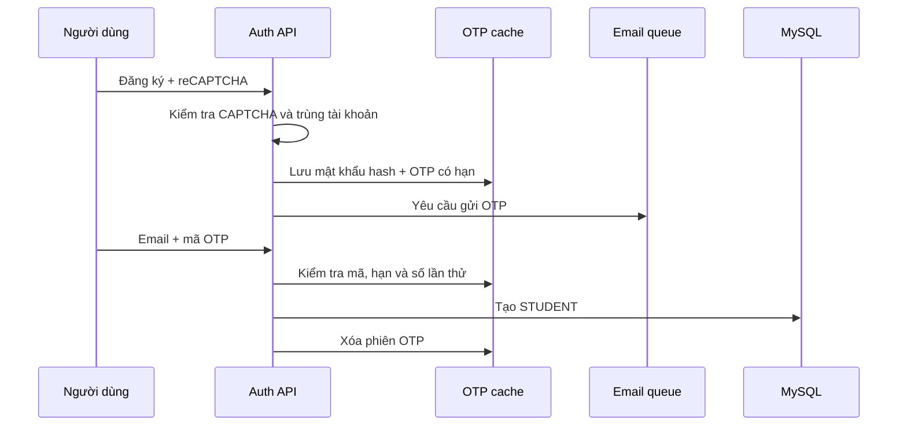

# Luồng đăng ký và xác thực OTP

## Đầu vào

Khách gửi `POST /api/auth/register` hoặc `/api/auth/register/init` gồm `username`, `password`, `fullName`, `email`, `recaptchaToken`. Username 3–20 ký tự, password 8–64, fullName 2–50 và email hợp lệ tối đa 100 ký tự.

## Xử lý

1. Backend xác minh reCAPTCHA, kiểm tra username/email chưa tồn tại. Không tạo user ngay tại bước nhập form.
2. Hash mật khẩu bằng BCrypt, loại recaptcha token khỏi dữ liệu lưu tạm.
3. Sinh OTP sáu chữ số bằng `SecureRandom`; lưu phiên theo email trong Caffeine, hạn 5 phút, số lần sai ban đầu bằng 0.
4. Gửi yêu cầu email vào `emailQueue`. Người dùng nhận thư qua SMTP; môi trường local xem Mailpit.
5. Người dùng gửi `POST /api/auth/register/verify` với `email`, `otp`.
6. Backend kiểm tra thời hạn và mã. Sai mã tăng bộ đếm; sai đến 5 lần thì xóa phiên.
7. Mã đúng: kiểm tra lại tính duy nhất username/email, tạo user với role STUDENT và mật khẩu đã hash; xóa phiên OTP.
8. Người dùng chuyển sang [đăng nhập](04-login.md).

## Lỗi và trạng thái

CAPTCHA không hợp lệ, dữ liệu sai hoặc tài khoản trùng sẽ bị từ chối. Khởi tạo/gửi lại quá sớm bị chặn trong 60 giây. Mã hết hạn, phiên không tồn tại hoặc đã bị khóa cần khởi tạo đăng ký lại. Restart backend làm mất phiên OTP chưa xác minh. Không thể tự chọn ADMIN qua payload đăng ký.

## Mã nguồn

[AuthController](../src/main/java/com/codepath/academy/controller/AuthController.java), [AuthServiceImpl](../src/main/java/com/codepath/academy/service/impl/AuthServiceImpl.java), [CacheConfig](../src/main/java/com/codepath/academy/config/CacheConfig.java), [gửi email](16-email-delivery.md).
