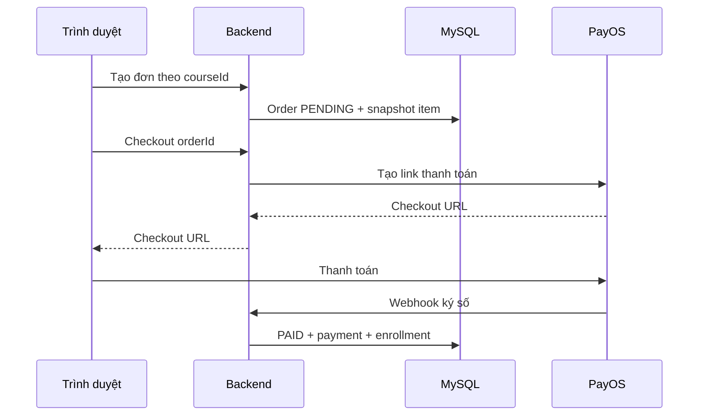

# Luồng mua khóa trả phí

## Điều kiện và API

User đăng nhập, khóa xuất bản, chưa có enrollment. Tạo đơn bằng `POST /api/orders` với `courseId`; lấy link bằng `POST /api/orders/{id}/checkout`.

## Trình tự

1. Backend khóa user, kiểm tra quyền mua, dùng lại đơn PENDING cùng khóa hoặc tạo đơn mới.
2. Giá và tổng tiền lấy từ database; order item lưu snapshot tên/giá tại thời điểm tạo.
3. Checkout khóa order, xác nhận người gọi là chủ đơn và trạng thái PENDING. ADMIN cũng không checkout hộ đơn của người khác.
4. Đã có checkout URL thì backend đối soát trạng thái với PayOS trước khi trả link. Nếu đã PAID và đúng số tiền, cấp quyền ngay và trả order PAID; nếu đã hủy/hết hạn, cập nhật trạng thái và không mở lại link cũ. Nếu chưa có link thì gọi PayOS với `orderCode=orderId`, tổng VND nguyên và mô tả `COURSE <id>`.
5. Return/cancel URL trỏ về frontend `/orders?order=<id>`.
6. Lưu link trả về, frontend điều hướng đến PayOS.
7. Trang `/orders?order=<id>` tự đối soát đơn PENDING có link khi tải và mỗi 10 giây. Có nút kiểm tra thủ công. Khi PAID, hiển thị xác nhận và đường dẫn vào học; không tự chuyển lại PayOS.
8. Quyền học được cấp bởi [webhook xác nhận](10-payment-webhook.md) hoặc [đối soát API PayOS](19-payment-reconciliation.md), không bởi redirect trình duyệt.
9. Trang chi tiết khóa học hiển thị link tới đơn đang chờ thay cho nút đăng ký mới. Khóa có enrollment hiển thị “Vào học”; backend từ chối tạo thêm đơn cho khóa đã sở hữu.

## Lỗi và trạng thái

PayOS chưa cấu hình trả 503; lỗi gateway không được coi là thành công. Checkout chỉ cho chủ đơn; đã PAID thì trả trạng thái PAID để vào học. Đối soát cập nhật CANCELLED/EXPIRED theo PayOS; người dùng có thể đăng ký lại để tạo đơn mới theo giá hiện tại. Đơn PENDING cũ vẫn giữ snapshot giá. Chưa có API hoàn tiền hoặc chủ động hủy link PayOS.

## Mã nguồn

[OrderService](../src/main/java/com/codepath/academy/service/OrderService.java), [PayOsGateway](../src/main/java/com/codepath/academy/service/PayOsGateway.java).
