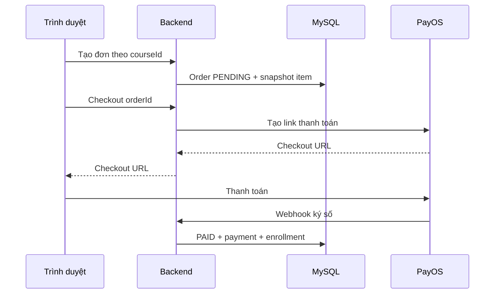

# Luồng mua khóa trả phí

## Điều kiện và API

User đăng nhập, khóa xuất bản, chưa có enrollment. Tạo đơn bằng `POST /api/orders` với `courseId`; lấy link bằng `POST /api/orders/{id}/checkout`.

## Trình tự

1. Backend khóa user, kiểm tra quyền mua, dùng lại đơn PENDING cùng khóa hoặc tạo đơn mới.
2. Giá và tổng tiền lấy từ database; order item lưu snapshot tên/giá tại thời điểm tạo.
3. Checkout khóa order, xác nhận người gọi là chủ đơn và trạng thái PENDING. ADMIN cũng không checkout hộ đơn của người khác.
4. Đã có checkout URL thì trả lại URL đó; chưa có thì gọi PayOS với `orderCode=orderId`, tổng VND nguyên và mô tả `COURSE<id>`.
5. Return/cancel URL trỏ về frontend `/orders?order=<id>`.
6. Lưu link trả về, frontend điều hướng đến PayOS.
7. Quyền học chỉ được cấp bởi [webhook xác nhận](10-payment-webhook.md), không bởi redirect trình duyệt.

## Lỗi và trạng thái

PayOS chưa cấu hình trả 503; lỗi tạo link trả lỗi gateway. Đơn không thuộc user hoặc không còn PENDING bị từ chối. Người dùng hủy ở trang thanh toán chỉ quay lại frontend; hiện chưa có API chuyển đơn sang CANCELLED, hoàn tiền hoặc tự tạo lại link hết hạn.

## Mã nguồn

[OrderService](../src/main/java/com/codepath/academy/service/OrderService.java), [PayOsGateway](../src/main/java/com/codepath/academy/service/PayOsGateway.java).
