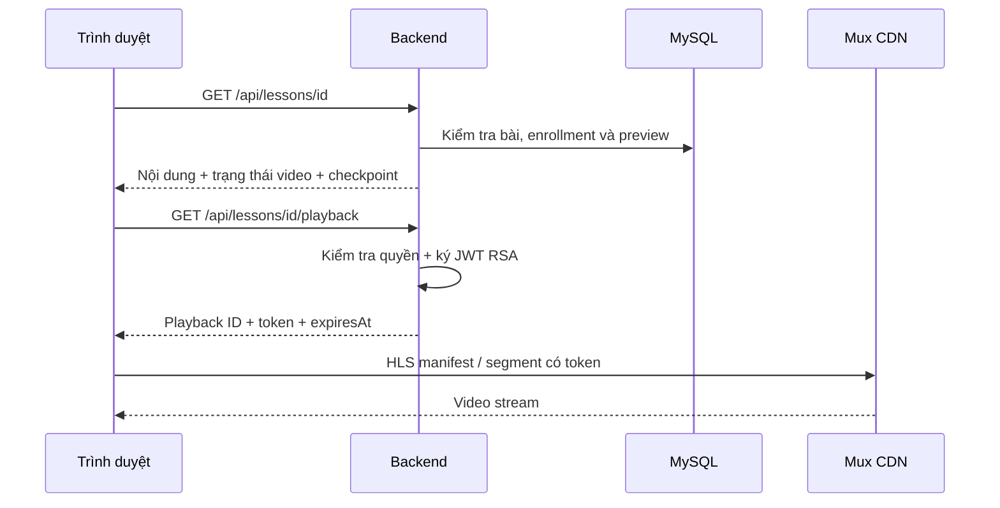

# Luồng phát video

## Quyền truy cập

Cho phép ADMIN, user đã có enrollment hoặc khách xem bài preview của khóa đã xuất bản. Quyền được kiểm tra tại API bài học và API cấp token phát.

## Trình tự

1. Trang học tải nội dung bài. Mux được ưu tiên nếu bài có trạng thái Mux; nếu không có Mux thì có thể phát URL video trực tiếp.
2. Với Mux, frontend gọi `GET /api/lessons/{id}/playback`.
3. Backend kiểm tra quyền hiện tại, trạng thái ready và playback ID. Video chưa sẵn sàng trả 409.
4. Backend ký JWT RS256 bằng private key: `kid` là signing key ID, `sub` là playback ID; audience `v`, `t`, `s` cho phát, thumbnail, storyboard.
5. Hạn token tính từ lúc cấp: số giây lớn hơn giữa 3600 và `durationMinutes * 60 + 900`.
6. Response dùng `Cache-Control: no-store`. Browser nhận token có hạn, không nhận private key/API secret.
7. Mux Player tải HLS trực tiếp từ Mux. Backend không chuyển tiếp byte video.
8. Khi metadata sẵn sàng, xử lý [popup tiếp tục xem](14-resume-confirmation.md) rồi phát.
9. Khi trang vẫn mở, frontend xin token mới mỗi 15 phút; có nút tải lại quyền phát sau lỗi.

## Giới hạn và lỗi

Đăng nhập JWT và JWT phát Mux độc lập. Ký token Mux không cần gọi API Mux mỗi lần, nhưng cần khóa đúng environment. Token đã cấp dùng được đến hết hạn; signed playback không phải DRM. URL video trực tiếp có cơ chế bảo vệ phụ thuộc nhà cung cấp URL, không tự được bảo vệ bởi signing key Mux.

Không ready, key sai environment, asset bị xóa hoặc lỗi mạng có thể làm player lỗi; cập nhật trạng thái trong quản trị rồi thử cấp lại token. Checkpoint chỉ được ghi khi player khởi tạo hợp lệ.

## Mã nguồn

[MuxVideoService](../src/main/java/com/codepath/academy/service/MuxVideoService.java), [CourseService](../src/main/java/com/codepath/academy/service/CourseService.java), [frontend source](../frontend/src).
