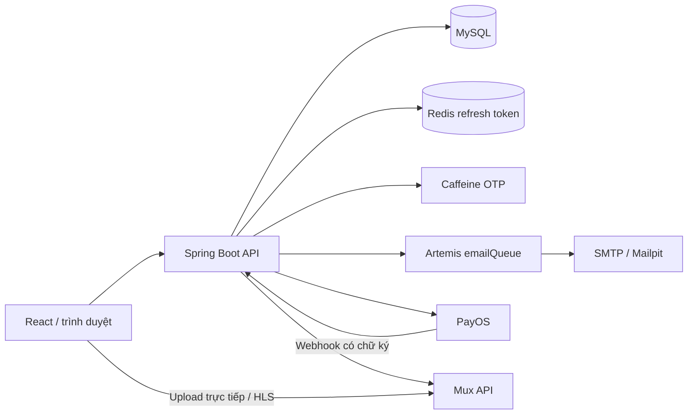

# Kiến trúc ứng dụng

CodePath Academy là ứng dụng học trực tuyến với backend Spring Boot và frontend React. Backend nằm trong namespace `com.codepath.academy`; điểm khởi động là `CodePathAcademyApplication`.

## Thành phần

| Thành phần | Trách nhiệm |
| --- | --- |
| Controller | Nhận HTTP, validation, truyền danh tính người dùng |
| Security | Xác thực JWT, tải quyền hiện tại từ database |
| Service | Kiểm tra quyền sở hữu, giao dịch và quy tắc nghiệp vụ |
| Repository / entity | Truy cập MySQL qua JPA |
| Gateway | Giao tiếp PayOS và Mux |
| Frontend | Điều hướng, biểu mẫu, phát video và checkpoint cục bộ |

MySQL là nguồn dữ liệu chính cho tài khoản, quyền học, đơn và tiến độ. Redis chỉ lưu refresh token. OTP nằm trong RAM backend. Video gốc và nội dung phát nằm trên Mux; database lưu các ID tham chiếu. Tệp `.qa` là tài nguyên kiểm thử local được bỏ qua bởi Git, không phải kho lưu video của ứng dụng.

## Ranh giới quyền truy cập

Catalog chỉ trả khóa xuất bản. Nội dung bài học và endpoint cấp quyền phát đều kiểm tra ADMIN, enrollment hoặc quyền xem thử. Không dựa vào việc ẩn nút trên giao diện để bảo vệ API. ADMIN quản lý nội dung, nhưng lưu tiến độ vào database vẫn cần enrollment.

API secret và private key chỉ ở backend. Trình duyệt nhận JWT đăng nhập, URL upload tạm thời và token phát có thời hạn. Signed playback không ngăn quay màn hình; URL kèm token có thể được sử dụng đến lúc hết hạn.

## Giới hạn hiện tại

OTP và broker email embedded phụ thuộc vòng đời tiến trình. Chưa có outbox bảo đảm gửi email sau giao dịch, webhook Mux, API hoàn tiền, thu hồi access token tức thì hoặc phân trang toàn bộ danh sách quản trị. Khi triển khai nhiều backend cần thiết kế lại OTP dùng chung và hàng đợi bền vững.

Xem [cấu hình](configuration.md), [dữ liệu](data-model.md) và [danh sách luồng](README.md).
