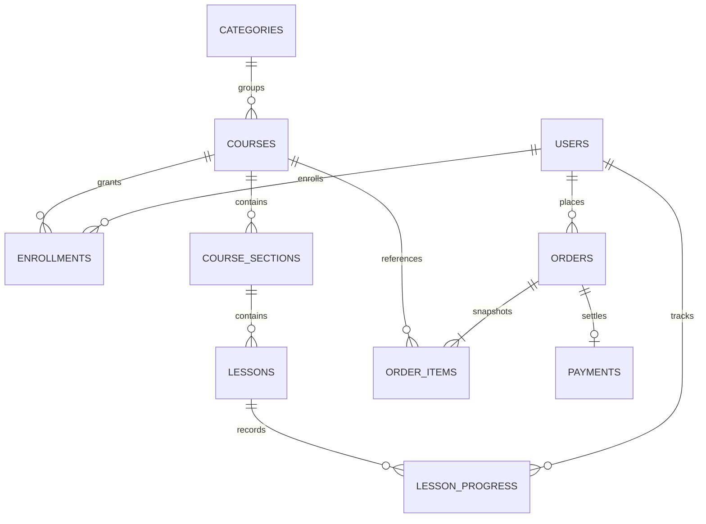

# Mô hình dữ liệu

| Bảng | Nội dung và quy tắc |
| --- | --- |
| users | Username/email duy nhất; mật khẩu BCrypt; role ADMIN hoặc STUDENT |
| categories | Danh mục khóa học |
| courses | Giá, mô tả, giảng viên, cấp độ, ảnh, trạng thái xuất bản |
| course_sections | Chương và thứ tự trong khóa |
| lessons | Bài, nội dung, URL video, thời lượng, preview; ID upload/asset/playback và trạng thái Mux |
| enrollments | Quyền học; cặp user/course duy nhất |
| orders | Chủ đơn, tổng tiền, trạng thái PENDING/PAID, thời điểm tạo/thanh toán |
| order_items | Snapshot tên và giá tại lúc mua, liên kết khóa học |
| payments | Kết quả thanh toán; order và external reference chống trùng |
| lesson_progress | Cặp user/lesson duy nhất; completed, vị trí, thời lượng, thời điểm checkpoint |
| flyway_schema_history | Lịch sử và checksum migration |

Giá trong database dùng số thập phân; tích hợp PayOS yêu cầu số VND nguyên. Tổng tiền lấy từ backend, không tin giá do trình duyệt cung cấp. Đơn miễn phí vẫn có order, payment và enrollment để thống nhất báo cáo.

Vị trí xem dùng giây; `positionUpdatedAt` là epoch millisecond để so với bản sao local. Thời lượng hiển thị bài học dùng phút; thời lượng checkpoint dùng giây. Không nhầm hai đơn vị khi tích hợp.

Schema được tạo bởi [V1](../src/main/resources/db/migration/V1__academy_schema.sql), sau đó bổ sung thông tin Mux và checkpoint bằng các migration tiếp theo trong [thư mục migration](../src/main/resources/db/migration). Giữ nguyên lịch sử migration để database hiện tại tiếp tục nâng cấp an toàn.

Refresh token lưu Redis với TTL, OTP lưu Caffeine, tệp video lưu Mux. Những dữ liệu này không nằm trong các bảng MySQL. Xóa lesson/chương phải xóa liên kết video Mux trước; API hiện không cung cấp thao tác xóa toàn bộ khóa học.
